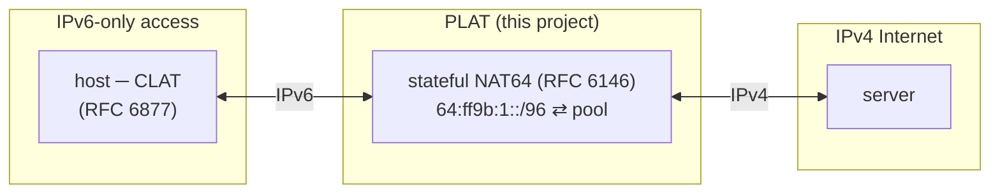
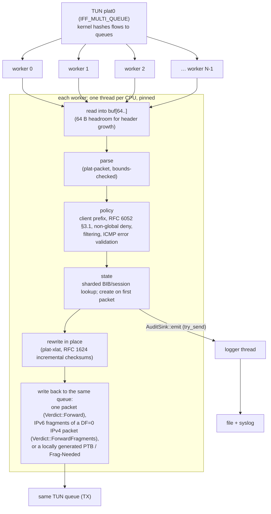
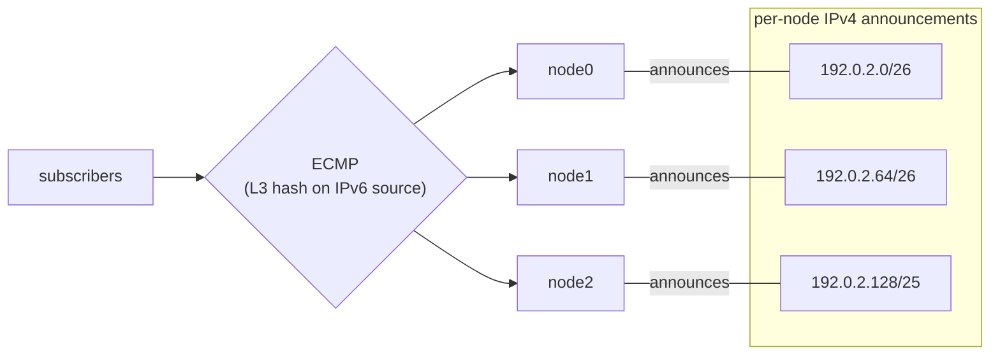

# usg-plat Architecture

## Role

A CLAT turns a host's IPv4 traffic into IPv6 addressed to the NAT64 prefix;
the PLAT maps each subscriber's IPv6 transport addresses onto a shared IPv4
pool and translates headers in both directions. The example configuration
uses `64:ff9b:1::/96` (RFC 8215 local-use space); the Well-Known Prefix
`64:ff9b::/96` is also supported and then requires a global pool.

## Data path

- **No per-packet allocation.** Each worker owns a 64 KiB packet buffer, a
  2 KiB scratch area (ICMP errors) and a 72 KiB fragment buffer, all
  allocated once. Translation rewrites the header in front of the payload
  instead of copying it.
- **Fragmentation (RFC 7915 §4).** A DF=0 IPv4 packet whose IPv6 form exceeds
  `translation.lowest_ipv6_mtu` (default 1280) is split into IPv6 fragments
  in the worker's fragment buffer; the worker transmits each in order. A DF=1
  packet that does not fit gets a rate-limited ICMPv4 Fragmentation Needed;
  an IPv6 packet too big for the IPv4 MTU gets an ICMPv6 Packet Too Big. The
  token bucket (`translation.icmp_errors_per_sec`) is per worker.
- **Back-pressure.** A full TUN queue (`EAGAIN`) drops the packet at once and
  counts `tx_queue_full`; the worker never sleeps on transmit.
- **Two shard locks per steady-state packet**: `bib6` (IPv6 key → IPv4 key)
  and `bib4` (session update). Shards are cache-line padded `parking_lot`
  mutexes; the shard count (default 1024) is far above the core count, so
  contention is rare.
- **Coarse clock.** Session timers read one relaxed atomic advanced every
  10 ms by a ticker thread instead of calling the OS per packet.
- **Counters** are per-worker, cache-line padded, relaxed atomics; metrics
  sum them.

## State

| Table | Key | Value | Lock |
|-------|-----|-------|------|
| `bib6` | (proto, v6 src, sport) | v4 transport address | shard |
| `bib4` | (proto, pool addr, pool port) | BIB + sessions `(remote addr, port) → expiry, TCP state` | shard |
| `subs` | v6 prefix (`subscriber_prefix_len`) | port blocks + per-protocol bitmaps | shard |
| `pool` | address index | FIFO free list of blocks; round-robin queue of addresses with free blocks | per-address mutex; one padded `avail` mutex taken only on block allocate/release |

- **Endpoint-independent mapping** (RFC 4787 REQ-1), **address-dependent
  filtering** by default (RFC 6146, O(1) through a per-BIB remote-address
  index kept only under ADF), **paired pooling** (REQ-2).
- **Bounded subscribers.** `nat64.max_subscribers` (default 1 000 000); a new
  subscriber is refused before any entry is created when the pool has no
  free block or the table is full.
- **Bulk port allocation** (RFC 7422 style): a subscriber receives blocks of
  `port_block_size` ports on one IPv4 address, up to
  `max_blocks_per_subscriber`. Ports inside a block are chosen randomly
  (RFC 6056). An empty block lingers 60 s before release to avoid log churn,
  and returns to the pool only after its release record is queued.
- **Sweeper** thread runs every `dataplane.sweep_interval_ms`: it walks every
  shard (no cursor or time budget, POAM-012), expires sessions, removes BIBs
  that have been empty for ≥ 2 s, and releases lingering blocks.

Lock order: `bib6 → subs` (released) `→ bib4`; sweeper `bib6 → bib4`
(released) then `subs`. Nothing acquires `bib6` or `subs` while holding `bib4`.

## SIEM logging

See `docs/compliance/SIEM_LOGGING.md` for the schema.

- Data plane builds a ≤ 48 byte plain-data event and calls `try_send` on a
  bounded MPMC queue (default 1 Mi events). It never blocks.
- The logger thread (`plat-audit`) drains up to `batch_max` events, formats
  JSON lines, writes the local file with one buffered write per batch and
  appends a SHA-256 checkpoint (chain v2: each file starts with an
  `audit_chain_continue` header that links it to the previous file). It then
  offers the batch, without blocking, to one sender thread per syslog
  destination (`plat-syslog-<i>`, bounded hand-off of 64 batches) that sends
  RFC 5424 syslog: one UDP datagram per record, or TCP octet-counted framing
  with one write per batch. A slow collector never stalls the file; its
  losses are recorded as `audit_remote_loss`.
- Under `on_overflow = "refuse_new_bindings"` (default; requires
  `[audit.file]`) a new mapping is refused if its attribution record cannot
  be queued, or while the pipeline is degraded (local file not writable, or
  free space below `audit.file.min_free_bytes`); existing mappings keep
  forwarding. Lost records are counted and reported as
  `audit_queue_overflow`; file failures as `audit_output_failure`.
- Files rotate at `max_bytes`; retention (`max_files`, default 0 = keep all)
  deletes the oldest rotated files only after a size rotation, recording each
  deletion first (`audit_retention_prune`).
- Port-block logging keeps volume low: one record per block allocation and
  release covers all of a subscriber's flows on that block.

## TLS, management and revocation

Crate `plat-tls` holds all TLS and PKI code: FIPS provider set-up
(`fips.rs`), the single TLS policy (`policy.rs`: TLS 1.3 only, FIPS suites,
X25519MLKEM768/P-256/P-384), key and certificate loading (`load.rs`), peer
identity and the typed allow-list (`identity.rs`), verifier wrappers that run
webpki and then the full-chain revocation check (`verify.rs`), deadline-bound
blocking TLS I/O (`stream.rs`) and the OCSP/CRL checker (`revocation/`).

**Crypto boundary.** The data plane (packet parsing, translation, NAT64
tables, cluster partitioning) remains pure Rust. Cryptography for TLS, OCSP
and CRL signatures and the DRBG is delegated to the AWS-LC FIPS module (C and
assembly, built by `aws-lc-fips-sys` through `aws-lc-rs`), installed as the
process-default rustls provider. `tls.require_fips = true` (default) makes
`platd` refuse to start unless the module reports FIPS mode. The audit hash
chain still uses the pure-Rust `sha2` crate. Builds with the `tls` feature
off contain no C crypto; they refuse TLS configs and, under the default
`require_fips`, refuse to start.

Additional threads (none touches the packet path):

| Thread | Role |
|--------|------|
| `plat-syslog-<i>` (`transport = "tls"`) | existing per-destination sender; now also performs the TLS handshake and the collector's chain revocation check |
| `plat-mgmt` | mTLS accept loop (non-blocking, 100 ms poll); enforces `max_connections` and `max_connections_per_ip` (IPv4 address / IPv6 /64) before any TLS work |
| `plat-mgmt-conn` | one per accepted connection: ClientHello deadline (2 s), handshake under `handshake_timeout_ms`, revocation, allow-list, one read-only request |
| `plat-revocation` | refresher: pre-fetches configured CRLs, refreshes watched CRLs/OCSP entries before nextUpdate, re-reads `crl.files`, emits `revocation_source_refresh` on transitions |

Start-up order: FIPS gate, audit queue, TLS material and revocation checker
(any failure exits before the logger starts), logger with TLS destinations,
`service_start`, data plane, refresher, management listener. Shutdown joins
the management threads before the logger stops so every connection record
is queued. Without `[management.tls]` the old single-thread loopback metrics
listener is used.

## Cluster scale-out

- Every node reads the same `nat64.pool`, `cluster.node_count`, and its own
  `node.id`, and computes a disjoint contiguous slice (`plat-cluster`).
  `platd check-config` prints the prefixes to announce;
  `platd check-config --format env` gives the same data to
  `plat-tun-setup.sh`, which routes only this node's slice to the TUN.
- IPv4 return traffic routes to the owning node, so no session state crosses
  nodes on the packet path. Adding capacity means adding a node and
  re-partitioning (or using `cluster.owned_pool` for explicit slices).
- The IPv6 side must keep a subscriber on one node: ECMP with L3-only
  hashing on the source address, or a load balancer that uses
  `owner_of_subscriber` (rendezvous hashing, ~1/N subscribers move on growth).
- Node failure affects only that node's subscribers (their flows re-establish
  on a survivor with a new mapping). Session-state replication for hitless
  failover is on the roadmap (POAM-007).
- Not automated or checked by the software (POAM-017): re-partitioning
  (changing `node_count` moves slices and disrupts the moved subscribers),
  IPv6-side steering, and detection of a duplicate `node.id` or overlapping
  `cluster.owned_pool` across nodes.

## Trust boundaries

| Boundary | Control |
|----------|---------|
| IPv6 access → PLAT | client prefix allow-list, ext-header bound, routing-header rejection, ICMPv6 error validation (live session, subscriber scope, sources inside the NAT64 prefix dropped); client source authenticity relies on access-edge SAVI/uRPF (POAM-014) |
| PLAT → IPv4 Internet | never-translatable destinations always denied; RFC 6890 non-global destinations denied by default under every prefix (`translation.allow_non_global_destinations`; the cluster pool is exempt) |
| IPv4 Internet → PLAT | pool ownership check, filtering, never-translatable and (by default) non-global data sources refused, unexpired source routes dropped |
| Host forwarding | nftables `inet plat` forward chain, default drop, installed by `plat-tun-setup.sh` before forwarding is enabled, persisted in `/etc/nftables.d/plat.nft` (glob include), and guarded by `plat-fwguard` (forwarding off if the table is missing or modified; residual window for direct `nft` changes, POAM-019). Verified on Linux (LINUX_VERIFICATION.md L5, L15) |
| Management | read-only metrics and health; plaintext only on loopback, otherwise mutual TLS 1.3 with client certificate, full-chain revocation and typed allow-list, per-IP and global connection caps; every mTLS connection audited |
| Revocation sources (OCSP responders, CRL distribution points) | plaintext HTTP of signed objects; strict DER and HTTP parsing, size caps, per-chain time budget; `hard_fail` by default; DNS has no timeout (POAM-025) |
| Audit destinations | local 0640 file in a `plat:plat-log` 2750 directory with an unkeyed hash chain (POAM-003); best-effort syslog to SIEM collectors; TLS 1.3 (RFC 5425) with CA-pinned, revocation-checked collectors when `transport = "tls"` |
