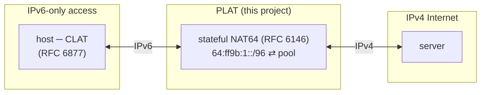
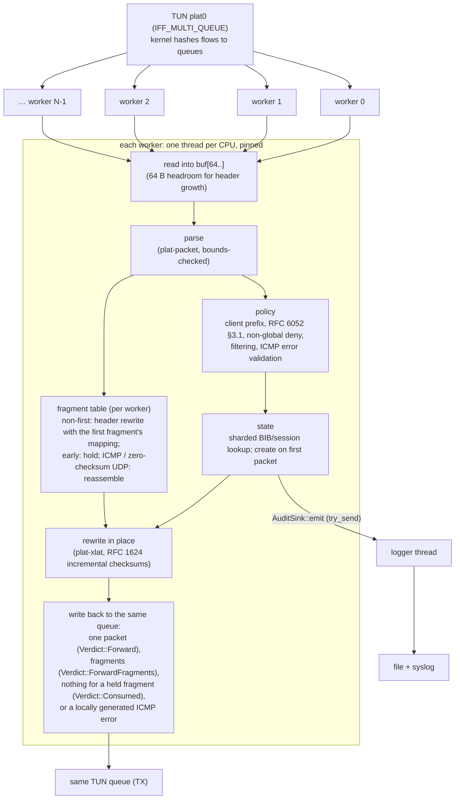
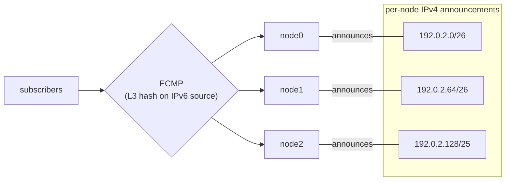
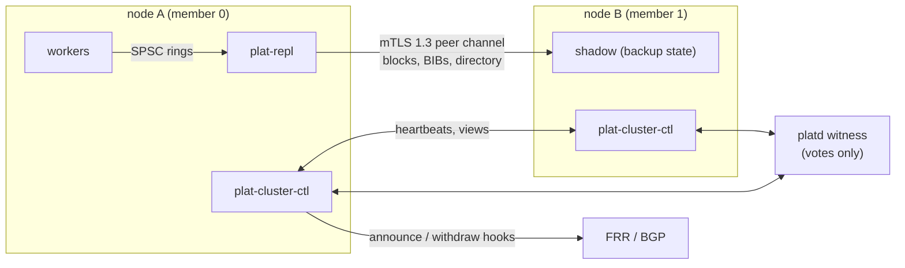

# usg-plat Architecture

## Role

A CLAT turns a host's IPv4 traffic into IPv6 addressed to the NAT64 prefix;
the PLAT maps each subscriber's IPv6 transport addresses onto a shared IPv4
pool and translates headers in both directions. The example configuration
uses `64:ff9b:1::/96` (RFC 8215 local-use space); the Well-Known Prefix
`64:ff9b::/96` is also supported and then requires a global pool.

## Data path

- **No per-packet allocation.** Each worker owns a 64 KiB packet buffer, a
  scratch area (ICMP errors and reassembly output; at least 2 KiB), a
  72 KiB output-fragment buffer (up to 128 packets), its fragment table and
  its IPv4 Identification table, all allocated once. Translation rewrites the header in front of the payload
  instead of copying it.
- **Fragmentation (RFC 7915 §4).** A DF=0 IPv4 packet whose IPv6 form exceeds
  `translation.lowest_ipv6_mtu` (default 1280) is split into IPv6 fragments
  in the worker's fragment buffer; the worker transmits each in order. A DF=1
  packet that does not fit gets a rate-limited ICMPv4 Fragmentation Needed,
  decided before the session update and only when the read-only
  `State::filter_inbound` admits it. An IPv6 packet of at most 1280 bytes
  whose IPv4 form exceeds `ipv4_mtu` is sent as IPv4 fragments (DF=0); a
  larger one gets an ICMPv6 Packet Too Big. The token bucket
  (`translation.icmp_errors_per_sec`) is per worker and shared by every
  locally generated error; a quarter is reserved for Packet Too Big and
  Fragmentation Needed.
- **Fragments (RFC 6146 §3.4, `crates/plat-nat64/src/frag.rs`).** Each
  worker owns a preallocated, randomly keyed 4-way set-associative table
  keyed by (src, dst, Identification, protocol, direction), sized by
  `[translation.fragments]`. The first fragment of a TCP/UDP datagram takes
  the normal path (filters, mapping, audit) and stores its translation;
  non-first fragments are translated by a header rewrite with that mapping,
  without a shard lock, and are re-checked against the pool slice. Fragments
  that arrive early are held in a bounded slot pool and flushed after the
  first fragment. Fragmented ICMP echo, ICMP errors and zero-checksum IPv4
  UDP are reassembled in a few bounded slots and then run the normal path.
  Entries expire `timeout_ms` after the first fragment (housekeeping every
  64 packets and on an idle receive); overlaps poison the datagram
  (RFC 5722); per-source caps keep one source from filling the table,
  buffer or slots. Locally generated errors quoting fragments we sent are
  mapped through alias entries. State is per worker: a fragment that reaches
  another worker is dropped (POAM-035; Linux multiqueue TUN kept fragments of
  one datagram on one queue in LINUX_VERIFICATION L24). A stored mapping has
  no BIB generation (POAM-034).
- **IPv4 Identification (RFC 7739 §5.3, `crates/plat-nat64/src/ident.rs`).**
  Each worker has 4096 16-bit counters with random initial values; a keyed
  hash of (source, destination, protocol) with a per-engine random key picks
  the counter and a per-flow offset; each packet advances the counter by a
  random 1..=8. A fragmented IPv6 datagram gets one fresh ID for all its
  IPv4 fragments. The key is redacted from `Debug`.
- **Locally generated ICMP errors.** Time Exceeded (both directions),
  Destination Unreachable when no mapping can be created, Parameter Problem
  for an active Routing header, opt-in inbound Unreachable and Source Route
  Failed; never about an ICMP error or a non-first fragment. See
  `docs/compliance/RFC_COMPLIANCE.md` for the deviations.
- **Back-pressure.** A full TUN queue (`EAGAIN`) drops the packet at once and
  counts `tx_queue_full`; the worker never sleeps on transmit.
- **Two shard locks per steady-state packet**: `bib6` (IPv6 key → IPv4 key)
  and `bib4` (session update). Shards are cache-line padded `parking_lot`
  mutexes; the shard count (default 1024) is far above the core count, so
  contention is rare.
- **Coarse clock.** Session timers read one relaxed atomic advanced every
  10 ms by a ticker thread instead of calling the OS per packet.
- **Counters** are per-worker, cache-line padded, relaxed atomics; metrics
  sum them.

### Performance profile on Linux

A TUN measurement in a Lima VM (Apple M2 Max, virtio; indicative only, see
README "Measured performance") showed TUN I/O dominating: about 86% of a
saturated worker's CPU is in the kernel (read and write syscalls, and the
forwarding of the translated packet, which runs synchronously inside
`write()`). The engine and translation take about 10%; shard-lock operations
about 0.7%, with no futex or slow-path samples, so locks are negligible at TUN
rates (about 0.45–0.62 Mpps per worker). Further throughput needs a different
I/O backend (POAM-016), not lock changes (POAM-015).

## State

| Table | Key | Value | Lock |
|-------|-----|-------|------|
| `bib6` | (proto, v6 src, sport) | v4 transport address | shard |
| `bib4` | (proto, pool addr, pool port) | BIB + sessions `(remote addr, port) → expiry, TCP state` | shard |
| `subs` | v6 prefix (`subscriber_prefix_len`) | port blocks + per-protocol bitmaps | shard |
| `aggs` | v6 prefix (`aggregate_prefix_len`) | subscriber count (entries only while > 0) | shard (leaf, under `subs`) |
| `pool` | address index | FIFO free list of blocks; round-robin queue of addresses with free blocks | per-address mutex; one padded `avail` mutex taken only on block allocate/release |

- **Endpoint-independent mapping** (RFC 4787 REQ-1), **address-dependent
  filtering** by default (RFC 6146, O(1) through a per-BIB remote-address
  index kept only under ADF), **paired pooling** (REQ-2).
- **Bounded subscribers.** `nat64.max_subscribers` (default 1 000 000); a new
  subscriber is refused before any entry is created when the pool has no
  free block or the table is full. At most
  `nat64.max_subscribers_per_aggregate` (default 256) subscribers share one
  `nat64.aggregate_prefix_len` (default 56) prefix (POAM-013 closed); the
  count changes only on subscriber create and removal.
- **Bulk port allocation** (RFC 7422 style): a subscriber receives blocks of
  `port_block_size` ports on one IPv4 address, up to
  `max_blocks_per_subscriber`. Ports inside a block are chosen randomly
  (RFC 6056). An empty block lingers 60 s before release to avoid log churn,
  and returns to the pool only after its release record is queued.
- **Sweeper** thread runs every `dataplane.sweep_interval_ms`: it walks every
  shard (no cursor or time budget, POAM-012), expires sessions, removes BIBs
  that have been empty for ≥ 2 s, and releases lingering blocks.

Lock order: `bib6 → subs (→ aggs)` (released) `→ bib4`; sweeper `bib6 → bib4`
(released) then `subs (→ aggs)`. Nothing acquires `bib6` or `subs` while holding `bib4`.
`aggs` is a leaf: taken briefly only while a `subs` shard is held (or alone),
and holds no other lock.

## SIEM logging

See `docs/compliance/SIEM_LOGGING.md` for the schema.

- Data plane builds a ≤ 48 byte plain-data event and calls `try_send` on a
  bounded MPMC queue (default 1 Mi events). It never blocks.
- The logger thread (`plat-audit`) drains up to `batch_max` events, formats
  JSON lines, writes the local file with one buffered write per batch and
  appends a SHA-256 checkpoint (chain v2: each file starts with an
  `audit_chain_continue` header that links it to the previous file). It then
  offers the batch, without blocking, to one sender thread per syslog
  destination (`plat-syslog-<i>`, bounded hand-off of 64 batches) that sends
  RFC 5424 syslog: one UDP datagram per record, or TCP octet-counted framing
  with one write per batch. A slow collector never stalls the file; its
  losses are recorded as `audit_remote_loss`.
- Under `on_overflow = "refuse_new_bindings"` (default; requires
  `[audit.file]`) a new mapping is refused if its attribution record cannot
  be queued, or while the pipeline is degraded (local file not writable, or
  free space below `audit.file.min_free_bytes`); existing mappings keep
  forwarding. Lost records are counted and reported as
  `audit_queue_overflow`; file failures as `audit_output_failure`.
- Files rotate at `max_bytes`; retention (`max_files`, default 0 = keep all)
  deletes the oldest rotated files only after a size rotation, recording each
  deletion first (`audit_retention_prune`).
- Port-block logging keeps volume low: one record per block allocation and
  release covers all of a subscriber's flows on that block.

## TLS, management and revocation

Crate `plat-tls` holds all TLS and PKI code: FIPS provider set-up
(`fips.rs`), the single TLS policy (`policy.rs`: TLS 1.3 only, FIPS suites,
X25519MLKEM768/P-256/P-384), key and certificate loading (`load.rs`), peer
identity and the typed allow-list (`identity.rs`), verifier wrappers that run
webpki and then the full-chain revocation check (`verify.rs`), deadline-bound
blocking TLS I/O (`stream.rs`) and the OCSP/CRL checker (`revocation/`).

**Crypto boundary.** The data plane (packet parsing, translation, NAT64
tables, cluster partitioning) remains pure Rust. Cryptography for TLS, OCSP
and CRL signatures and the DRBG is delegated to the AWS-LC FIPS module (C and
assembly, built by `aws-lc-fips-sys` through `aws-lc-rs`), installed as the
process-default rustls provider. `tls.require_fips = true` (default) makes
`platd` refuse to start unless the module reports FIPS mode. The audit hash
chain still uses the pure-Rust `sha2` crate. Builds with the `tls` feature
off contain no C crypto; they refuse TLS configs and, under the default
`require_fips`, refuse to start.

Additional threads (none touches the packet path):

| Thread | Role |
|--------|------|
| `plat-syslog-<i>` (`transport = "tls"`) | existing per-destination sender; now also performs the TLS handshake and the collector's chain revocation check |
| `plat-mgmt` | mTLS accept loop (non-blocking, 100 ms poll); enforces `max_connections` and `max_connections_per_ip` (IPv4 address / IPv6 /64) before any TLS work |
| `plat-mgmt-conn` | one per accepted connection: ClientHello deadline (2 s), handshake under `handshake_timeout_ms`, revocation, allow-list, one read-only request |
| `plat-revocation` | refresher: pre-fetches configured CRLs, refreshes watched CRLs/OCSP entries before nextUpdate, re-reads `crl.files`, emits `revocation_source_refresh` on transitions |

Start-up order: FIPS gate, audit queue, TLS material and revocation checker
(any failure exits before the logger starts), logger with TLS destinations,
`service_start`, data plane, refresher, management listener. Shutdown joins
the management threads before the logger stops so every connection record
is queued. Without `[management.tls]` the old single-thread loopback metrics
listener is used.

## Cluster scale-out

Three partition modes, chosen by `cluster.partition` and `[cluster.ha]`
(`service_start` records the mode as `cluster.mode`):

| Mode | Ownership | Failover |
|------|-----------|----------|
| `contiguous` (default, legacy) | each node computes a disjoint contiguous share of `nat64.pool` from `cluster.node_count` and its `node.id` (or `cluster.owned_pool`) | none: a lost node's subscribers re-establish on a survivor with a new mapping |
| `slices` without HA | the pool is cut into fixed slices (`cluster.slice_prefix_len`, default /28, at most 4096); each node takes its weighted-rendezvous primaries of the full member set at start | none |
| `slices` with `[cluster.ha] enabled = true` | primaries and backups come from rendezvous over the **live** members of the current view and move at run time | backup takes over with the same mappings |

Legacy notes (both non-HA modes):

- `platd check-config` prints the prefixes to announce;
  `platd check-config --format env` gives the same data to
  `plat-tun-setup.sh`, which routes only this node's share to the TUN.
- IPv4 return traffic routes to the owning node, so no session state crosses
  nodes on the packet path.
- The IPv6 side must keep a subscriber on one node: ECMP with L3-only
  hashing on the source address, or a load balancer that uses
  `owner_of_subscriber`.
- Duplicate `node.id` or overlapping `cluster.owned_pool` is not detected by
  the software (no peer channel); compare `cluster.config_digest` in the
  SIEM (POAM-017(c)).

### Cluster high availability (`feat/cluster-ha`, unreleased)

Tested in-process (loopback mTLS, simulated clocks and links); the three-VM
test (LINUX_VERIFICATION L19–L23) is not yet run.

- **Membership** (`crates/plat-cluster`, sans-IO): the configured members plus
  an optional witness vote; the leader issues **views** (`epoch`, live
  members, standby) and grants round-trip-anchored leases (`lease_ms` 3000,
  `heartbeat_ms` 500, `drift_margin_pct` 10). A member self-fences at
  `lease × (1 − m)`; a new owner starts no earlier than
  `lease × (1 + m) + 200 ms` after the last grant, or at the old owner's
  `HandoverFence`. Only monotonic clocks are used. Epochs and votes are
  persisted in `state_dir/cluster.state` (fsynced before acting). Automatic
  failover needs a quorum that survives one loss: 3+ members, or 2 members
  plus `platd witness`; otherwise `auto_failover = false` and takeover is an
  operator command.
- **Ownership in the engine**: each slice has an `AtomicU8` state
  (`Inactive`, `Adopting`, `Active`, `Fenced`). The worker path checks it with
  one relaxed load (the BIB stores the pool index); the legacy path is a
  separate monomorphised copy without the check. Non-owned slices drop as
  `wrong_node`, fenced or adopting ones as `cluster_fenced`.
- **Replication** (asynchronous, ordered per slice): workers and the sweeper
  push block, BIB and directory records into bounded per-worker SPSC rings
  (no lock, allocation or syscall; a full ring drops, counts and marks the
  slice dirty). `plat-repl` sends a snapshot then the stream to the slice's
  backup; the backup is **in sync** after the snapshot end is acked. Sessions
  are not replicated.
- **Block reservation**: while an in-sync backup exists, the primary hands
  out only blocks the backup has acked in a `Reserve` (top-up off the packet
  path, `reserve_ahead_blocks`), so no block is used that the backup cannot
  know about.
- **Takeover**: the gaining node takes the shadow, queues
  `cluster_slice_acquire` and one `nat_port_block_adopt` per block, imports
  blocks and BIBs, rebuilds the free list (unknown reserved blocks held for
  `takeover_quarantine_secs`, recent releases finish their cool-down) and
  only then sets the slice Active and runs the announce hook. Adopted TCP
  BIBs accept a pickup on the transitory timer for `tcp_adopt_secs`
  (POAM-028).
- **Handover** (failback, growth, graceful shutdown): the old owner fences,
  flushes, logs release(`handover`) records, runs the withdraw hook and sends
  `HandoverFence`; the new owner adopts. A view moves every affected slice at
  once (no leader-side batching; POAM-017(a)). Shutdown has no leave message
  (POAM-030).
- **Peer channel** (`services/platd/src/cluster/peer.rs`): mutual TLS 1.3 via
  `plat_tls::peer_configs` (FIPS, no resumption, both EKUs). The accepting
  side pins the source address to `members[id].peer_addr` before TLS
  (the dialer does not bind its source, POAM-031); after TLS a `Hello`
  checks version, identity ↔ claimed id, digest, overlap and duplicate id.
  Control frames go before data; data queues are bounded and lossy (counted,
  resync). Replication is accepted only from the slice's primary or recorded
  handover source. All members share one trust domain (POAM-032).
- **Steering**: every node keeps a subscriber directory (`SubHome`/`SubGone`);
  on subscriber creation a remote home is counted and, by default with HA,
  dropped (`missteered`). Forwarding to the owner is phase 2
  (POAM-017(b)).
- **Routes**: platd does not speak BGP. Serialized out-of-process hooks
  (`<slice-cidr> <epoch> <reason>`, cleared environment, own process group,
  killed on timeout, directory ownership re-checked before each exec) plus
  `state_dir/announce.d/`. With HA `plat-tun-setup.sh` routes the whole pool
  (`PLAT_POOL_ALL`) to the TUN because ownership changes at run time.
- **Operator**: `platd cluster status|takeover --member N [--force]|restore
  --member N` over `state_dir/ctl.sock` (uid 0 or the daemon uid, from peer
  credentials; served one client at a time, POAM-033); every takeover,
  restore and refusal is audited (`cluster_operator_command`). `GET /cluster`
  on the management listener returns the view and slice owners.
- **Threads** (no async runtime): `plat-peer-accept`, `plat-peer-in`,
  `plat-peer-<id>`, `plat-cluster-ctl` (ticks at heartbeat/10),
  `plat-repl`, `plat-cluster-hook`, `plat-cluster-cli`. None is on the
  packet path.
- **Failover time** (simulation): member crash ≤ about 4.7 s, leader crash
  up to about 6.2 s, against a 5 s target; pending three-VM data (POAM-007).

## Trust boundaries

| Boundary | Control |
|----------|---------|
| IPv6 access → PLAT | client prefix allow-list, ext-header bound, routing-header rejection, ICMPv6 error validation (live session, subscriber scope, sources inside the NAT64 prefix dropped); client source authenticity relies on access-edge SAVI/uRPF (POAM-014) |
| PLAT → IPv4 Internet | never-translatable destinations always denied; RFC 6890 non-global destinations denied by default under every prefix (`translation.allow_non_global_destinations`; the cluster pool is exempt) |
| IPv4 Internet → PLAT | pool ownership check, filtering, never-translatable and (by default) non-global data sources refused, unexpired source routes dropped; pool-sourced packets refused (own slice always, other slices unless `translation.cross_node_hairpin`, which needs the host `plat-pool-source-guard` rule limiting them to `translation.cluster_interfaces`; POAM-024) |
| Host forwarding | nftables `inet plat` forward chain, default drop, installed by `plat-tun-setup.sh` before forwarding is enabled, persisted in `/etc/nftables.d/plat.nft` (glob include), and guarded by `plat-fwguard` (forwarding off if the table is missing or modified; residual window for direct `nft` changes, POAM-019). Verified on Linux (LINUX_VERIFICATION.md L5, L15) |
| Cluster peers (HA) | mutual TLS 1.3 with a dedicated peer CA, typed identity bound to the claimed member id, source address pinned on the accepting side, config digest cross-check, duplicate-id refusal, replication accepted only from the slice owner; one trust domain (POAM-032); operator socket limited to uid 0 or the daemon uid |
| Management | read-only metrics and health; plaintext only on loopback, otherwise mutual TLS 1.3 with client certificate, full-chain revocation and typed allow-list, per-IP and global connection caps; every mTLS connection audited |
| Revocation sources (OCSP responders, CRL distribution points) | plaintext HTTP of signed objects; strict DER and HTTP parsing, size caps, per-chain time budget; `hard_fail` by default; DNS has no timeout (POAM-025) |
| Audit destinations | local 0640 file in a `plat:plat-log` 2750 directory with an unkeyed hash chain (POAM-003); best-effort syslog to SIEM collectors; TLS 1.3 (RFC 5425) with CA-pinned, revocation-checked collectors when `transport = "tls"` |
