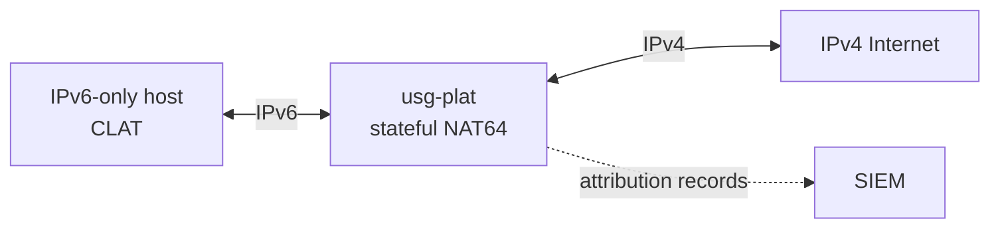

# usg-plat

Pure-Rust, multithreaded **464XLAT PLAT** ([RFC 6877](https://www.rfc-editor.org/rfc/rfc6877)):
stateful NAT64 ([RFC 6146](https://www.rfc-editor.org/rfc/rfc6146)) with SIIT
translation ([RFC 7915](https://www.rfc-editor.org/rfc/rfc7915)),
[RFC 6052](https://www.rfc-editor.org/rfc/rfc6052) address mapping, bulk port
allocation, high-speed SIEM attribution logging, and stateless cluster
scale-out. Built for NIST SP 800-53 Rev 5 ATO readiness.

-   :lucide-rocket: **Getting started**

    ---

    Build, validate a config, and install `platd` under systemd.

    [Quick start](getting-started.md)

-   :lucide-workflow: **Architecture**

    ---

    Data path, run-to-completion workers, state tables, cluster design and
    trust boundaries.

    [Architecture](architecture.md)

-   :lucide-shield-check: **Compliance**

    ---

    NIST 800-53 control mapping, RFC conformance, SIEM log schema and POA&M.

    [Compliance](compliance/index.md)

-   :lucide-gauge: **Performance**

    ---

    Criterion results for translation, NAT64 state and audit logging.

    [Performance](performance.md)

## Highlights

- **Packets are hostile.** All parsing goes through bounds-checked
  `plat-packet`; malformed input becomes a counted drop reason, never a panic.
- **No allocation, blocking I/O or global lock on the hot path.** One pinned
  worker per CPU on a multiqueue TUN, sharded tables, at most one shard lock
  per table.
- **Bounded everything (SC-5).** Sessions, bindings, subscribers, queues and
  locally generated ICMP errors all have configured limits.
- **Attribution first (AU-12, AU-5).** A port block or binding is never used
  before its audit record is queued; logs export as JSON, CEF or RFC 5424
  syslog into a SHA-256 chained file that `platd verify-log` checks.
- **Scale-out without shared state.** Deterministic pool partitioning and
  rendezvous hashing split the IPv4 pool across cluster nodes.

## Workspace

| Crate | Role |
|-------|------|
| `plat-common` | Config (TOML, validated), CIDR types, coarse clock, per-worker counters |
| `plat-packet` | Bounds-checked IPv4/IPv6/L4 parsing, RFC 1071/1624 checksums |
| `plat-xlat` | RFC 6052 mapping, RFC 7915 in-place header translation, ICMP error translation |
| `plat-nat64` | Sharded BIB/session/subscriber tables, port blocks, TCP FSM, sweeper, engine |
| `plat-audit` | Non-blocking SIEM logging: JSON/CEF, RFC 5424 syslog, SHA-256 chained file |
| `plat-io` | `PacketQueue` trait, Linux multiqueue TUN, in-memory queue |
| `plat-cluster` | Deterministic pool partitioning, CIDR cover, rendezvous hashing |
| `platd` | Daemon: workers, sweeper, clock, metrics, `check-config`, `verify-log` |

!!! note "Linux verification pending"
    The Linux-specific behaviour (systemd sandbox, nftables forward policy,
    TUN attach) has not been run yet. See the
    [Linux verification checklist](compliance/LINUX_VERIFICATION.md).
